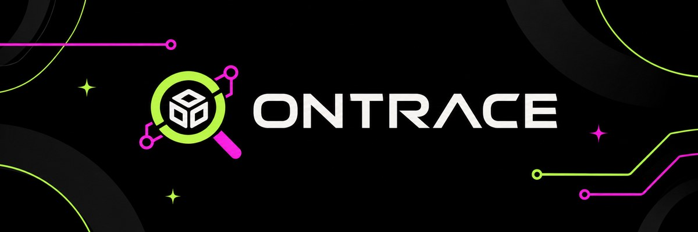
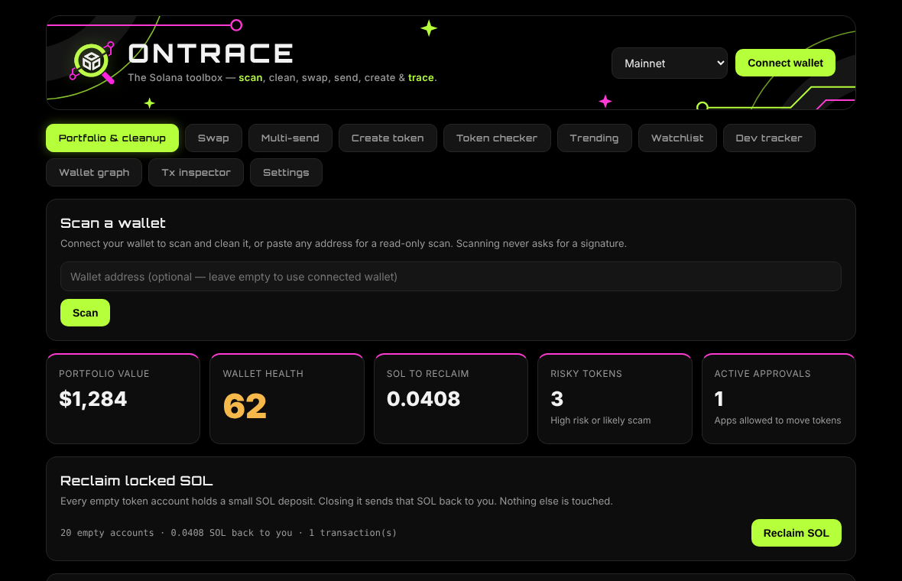
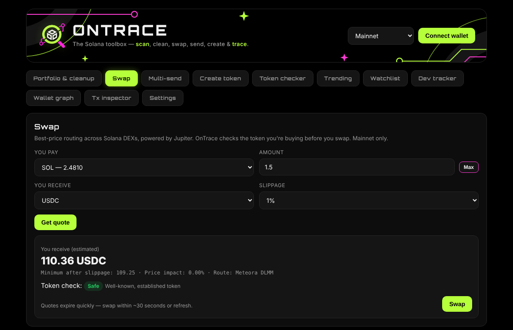
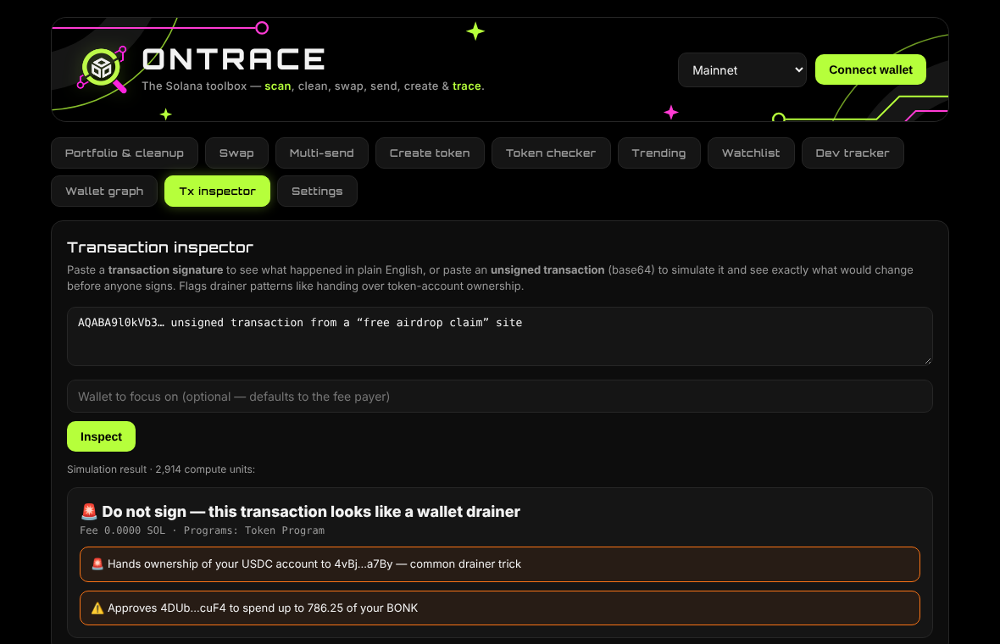
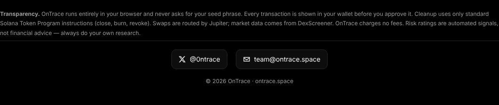

<p align="center">
  
</p>

<h1 align="center">OnTrace</h1>

<p align="center">
  <strong>Trace it before you trust it.</strong><br>
  The free Solana toolbox — scan, clean, swap, send, create and trace.
</p>

<p align="center">
  <a href="https://ontrace.space">ontrace.space</a> ·
  <a href="https://x.com/0ntrace">@0ntrace on X</a> ·
  <a href="mailto:team@ontrace.space">team@ontrace.space</a>
</p>

---

## Table of contents

- [What is OnTrace?](#what-is-ontrace)
- [Pages](#pages)
- [Why it exists](#why-it-exists)
- [Features](#features)
  - [Portfolio & cleanup](#1-portfolio--cleanup)
  - [Swap](#2-swap)
  - [Multi-send](#3-multi-send)
  - [Create token](#4-create-token)
  - [Token checker](#5-token-checker)
  - [Trending](#6-trending)
  - [Watchlist & live alerts](#7-watchlist--live-alerts)
  - [Dev tracker](#8-dev-tracker)
  - [Wallet graph](#9-wallet-graph)
  - [Transaction inspector](#10-transaction-inspector)
- [Safety model](#safety-model)
- [How the risk ratings work](#how-the-risk-ratings-work)
- [Screenshots](#screenshots)
- [Tech stack](#tech-stack)
- [Project structure](#project-structure)
- [Run it yourself](#run-it-yourself)
- [Configuration](#configuration)
- [Deployment](#deployment)
- [Testing & verification](#testing--verification)
- [Known limitations](#known-limitations)
- [Roadmap](#roadmap)
- [FAQ](#faq)
- [Contributing & reporting issues](#contributing--reporting-issues)
- [Disclaimer](#disclaimer)
- [License](#license)

---

## What is OnTrace?

OnTrace is a free, browser-based toolbox for Solana users. It brings the everyday jobs of a Solana wallet into one place:

- **See what's really in your wallet** — value, health score, and a risk rating on every token.
- **Clean it up** — reclaim SOL locked in empty token accounts, burn spam tokens, revoke risky approvals.
- **Trade and move funds** — best-price swaps, multi-wallet sends, and token creation with safe defaults.
- **Investigate** — watch wallets, get alerts, trace token developers, map wallet relationships, and decode transactions before you sign them.

Everything runs **in your browser**. There is no OnTrace server, no account, no sign-up, and no fees. OnTrace never sees your seed phrase, and nothing happens without your wallet's approval.

## Pages

| Page | URL |
|---|---|
| App | https://ontrace.space |
| Documentation | https://ontrace.space/docs.html |
| FAQ | https://ontrace.space/faq.html |
| Security | https://ontrace.space/security.html |
| Terms & Privacy | https://ontrace.space/terms.html |

Tools can be linked directly with a hash, e.g. `https://ontrace.space/#swap`, `#check`, `#trending`, `#inspect`.

## Why it exists

Solana moves fast. New tokens launch every minute, and many of them are traps: fake market caps, frozen balances, creators who mint unlimited supply, airdropped spam that leads to drainer sites. At the same time, ordinary wallets quietly lose SOL to hundreds of empty token accounts.

OnTrace exists to make those risks visible and fixable by anyone — not just people who can read raw on-chain data.

---

## Features

### 1. Portfolio & cleanup

| Tool | What it does |
|---|---|
| **Wallet scan** | Reads every token account (both the classic Token Program and Token-2022) and shows total portfolio value, SOL balance, and a 0–100 **wallet health score**. |
| **Read-only mode** | Paste *any* wallet address to scan it without connecting a wallet. Cleanup buttons stay disabled. |
| **Reclaim SOL** | Every token account holds a small rent deposit (~0.002 SOL). Empty accounts keep that SOL locked. OnTrace closes them in batches (20 per transaction) and sends the SOL back to you. |
| **Risk ratings** | Every token gets a rating — *Safe*, *Caution*, *High risk* or *Likely scam* — with the reasons listed. See [How the risk ratings work](#how-the-risk-ratings-work). |
| **Burn junk** | Tick spam or worthless tokens and OnTrace burns them and closes their accounts, returning the deposit. High-risk, near-zero-value tokens are pre-selected. A confirmation dialog shows the estimated value being destroyed before anything is sent. |
| **Approvals manager** | Lists every token account with an active *delegate* (someone allowed to move your tokens), labels whether the delegate is an app/program or a **personal wallet** (a red flag), and revokes selected approvals in bulk. |
| **Unwrap SOL** | Converts wrapped SOL (wSOL) back into native SOL. |

**Health score** starts at 100 and deducts for empty accounts, likely-scam and high-risk tokens, active approvals, and dust.

### 2. Swap

- Best-price routing across Solana DEXs (Raydium, Orca, Meteora, PumpSwap and more) via **Jupiter's Swap API**.
- Pick any token you hold as input; choose a common output (SOL, USDC, USDT, JUP, BONK) or paste any token address.
- Slippage presets from 0.5% (stablecoins) to 10% (fast-moving memecoins).
- The quote shows: estimated output, minimum after slippage, price impact, and the route used.
- **Automatic safety check** on the token you're buying. If it's rated *High risk* or *Likely scam*, you must tick an acknowledgement box before the Swap button works.
- High price-impact warning (above 3%).
- **Max** button keeps a small SOL reserve for fees.
- Mainnet only (Jupiter doesn't route on devnet).

### 3. Multi-send

- Send SOL or any SPL/Token-2022 token to many wallets at once — airdrops, team payouts, giveaways.
- Paste one recipient per line: `address, amount` (commas, spaces or semicolons all work). A default amount fills in lines without one.
- **Check list** validates every address and amount first, flags duplicates, shows totals and the number of transactions, and warns if your balance is too low.
- Recipients without a token account get one created automatically (you pay the ~0.002 SOL deposit per new account).
- Batches: 18 SOL transfers or 5 token transfers per transaction.

### 4. Create token

Launch a Solana token from the browser using the **Token-2022** standard with **on-chain metadata** (name, symbol and a metadata link stored directly on the mint).

- Name (up to 32 characters), symbol (up to 10), total supply, and decimals (0, 2, 6 or 9).
- Optional metadata link — a JSON file with your logo and description (template shown in the app).
- **Safe defaults:**
  - **No freeze authority, ever** — nobody, including the creator, can freeze holders' tokens.
  - **Lock supply** (on by default) — revokes mint authority so no more tokens can ever be created.
  - **Lock name & logo** (optional) — removes the metadata update authority permanently.
- Shows the estimated cost before you create.
- After creation: copy the mint address, open it on Solscan, and get guidance on adding a liquidity pool (Raydium / Meteora) so it can trade.

### 5. Token checker

Paste any token mint to see:

- Name, symbol and risk rating with reasons
- Price, market cap, liquidity, 24h change, 24h trades and pair age
- Whether **mint authority** and **freeze authority** are still active
- Links to the chart and to swap

### 6. Trending

- Solana tokens currently getting attention on DexScreener (latest profiles and top boosts).
- Sort by 24h volume, 24h change, market cap or newest.
- **Boosted** tokens are labelled — boosts are paid promotion, not organic demand.
- Quick risk rating on every row, plus one-click **Check** and **Swap**.

### 7. Watchlist & live alerts

**Watchlist**
- Follow any wallets — whales, developers, smart traders, your own. Saved only in your browser.
- Each row shows SOL balance, portfolio value, token count and last activity.
- **Activity** opens that wallet's last 10 transactions, each explained in plain English (e.g. *"Bought 12.5K BONK for 0.3 SOL"*).

**Live alerts**
- Polls watched wallets every 30 seconds and shows new activity in an alert feed, with browser notifications.
- Alert rules: all activity, buys/sells/swaps only, or moves above a SOL threshold.
- Anything flagged as risky (e.g. an approval or a drainer pattern) always alerts.
- Runs while OnTrace is open in a browser tab.

### 8. Dev tracker

Paste a token mint to investigate who's behind it:

- **Finds the creator** — the wallet that paid for the token's first transaction (reads the token's history back to the beginning, up to 15,000 transactions). Falls back to the mint authority, or you can paste a known dev wallet.
- **Dev holdings** — how much of the supply the creator still holds, and their SOL balance.
- **Dev activity** — the creator's recent moves with this token (buys, sells, transfers), explained in plain English.
- **Top holders** — the 20 largest holders with % of supply. Pools and program accounts are labelled; the dev is highlighted.
- **Signals** — warnings for large dev holdings, recent dev selling, and top-10 concentration.
- One click to **watch** the dev or any holder, or map the dev's connections.

### 9. Wallet graph

- Reads a wallet's last 50, 100 or 200 transactions and finds who it interacts with most (SOL and token counterparties).
- Draws a **radial graph**: line thickness shows how often they interact; **magenta** lines mean this wallet sent them SOL, **lime** means they sent this wallet SOL.
- **Grey nodes are programs or pools** (addresses that aren't on the ed25519 curve, so no person holds a key).
- Click any node to explore that wallet next. A table lists every counterparty with transaction counts, SOL in/out and tokens involved.

### 10. Transaction inspector

Two modes in one box:

- **Paste a transaction signature** → see what happened in plain English, the fee, programs used, warnings, and a full table of balance changes.
- **Paste an unsigned transaction (base64)** → OnTrace **simulates** it against the current chain state and shows exactly what would change *before anyone signs*.

Drainer detection includes:
- 🚨 **Token-account ownership hand-over** (the most common Solana drainer trick) → headline changes to *"Do not sign — this transaction looks like a wallet drainer."*
- ⚠️ New spending approvals (who, and how much)
- ⚠️ Accounts closed to someone else's address
- Calls to unrecognised programs

---

## Safety model

| Principle | How OnTrace follows it |
|---|---|
| **No custody** | OnTrace never holds funds or keys. Your wallet signs everything. |
| **No seed phrases** | The app never asks for one. If any site claiming to be OnTrace does, it's fake. |
| **Read-only by default** | Scanning, checking, watching and inspecting never request a signature. |
| **Minimal instructions** | Cleanup uses only standard Token Program instructions: `CloseAccount` (9), `Burn` (8) and `Revoke` (5). Their encoding was verified byte-for-byte against the official `@solana/spl-token` library. |
| **Explicit confirmation** | Burns, multi-sends and token creation show a confirmation summary first. Risky swaps need an acknowledgement. |
| **No backend** | No database, no analytics, no tracking. Watchlists and settings stay in your browser's local storage. |
| **Open source** | This repository *is* the site. What you read here is what runs at ontrace.space. |

See [SECURITY.md](SECURITY.md) for more, including how to report a vulnerability.

---

## How the risk ratings work

Ratings combine **live market data** (from DexScreener) with **on-chain mint settings** (read directly from Solana). The highest-level signal wins.

| Signal | Level |
|---|---|
| Well-known token (SOL, USDC, USDT, PYUSD, JUP, BONK, mSOL, JitoSOL, JupSOL, bSOL) | Safe |
| Market cap over $100K, more than 100× its liquidity, and fewer than 50 trades in 24h (*fake market cap*) | **Likely scam** |
| Token-2022 **permanent delegate** (someone can move tokens out of any holder's wallet) | **Likely scam** |
| No trading market found (often spam airdrops or dead tokens) | High risk |
| Liquidity under $1,000 (you may not be able to sell) | High risk |
| **Freeze authority** active (creator can freeze your tokens) | High risk |
| Mint authority active (creator can mint more) | Caution |
| Fewer than 10 trades in 24h | Caution |
| Trading pair less than 24 hours old | Caution |
| Custom transfer hook (transfers run creator code) | Caution |
| Transfer fee on every transfer | Caution |

Full details: [docs/RISK-ENGINE.md](docs/RISK-ENGINE.md).

> Ratings are automated signals to help you ask better questions. They are **not** financial advice and can't catch every scam.

---

## Screenshots

| Portfolio & cleanup | Swap |
|---|---|
|  |  |

| Transaction inspector catching a drainer | Footer |
|---|---|
|  |  |

*Screenshots use sample data.*

---

## Tech stack

| Layer | Choice |
|---|---|
| App | One self-contained `index.html` — HTML, CSS and a JavaScript module. No build step, no framework. |
| Solana | [`@solana/web3.js`](https://github.com/solana-labs/solana-web3.js) 1.98, [`@solana/spl-token`](https://github.com/solana-labs/solana-program-library) 0.4.9, [`@solana/spl-token-metadata`](https://github.com/solana-labs/solana-program-library) 0.1.6 — loaded as ES modules from [esm.sh](https://esm.sh) |
| RPC | Any Solana RPC (Helius recommended). Transaction history is fetched directly over JSON-RPC so Solana's newest (version 1) transactions are supported. |
| Swaps | [Jupiter Swap API](https://dev.jup.ag) (`lite-api.jup.ag/swap/v1`) |
| Market data | [DexScreener API](https://docs.dexscreener.com) |
| Wallets | Phantom, Solflare, Backpack (injected providers) |
| Font | [Orbitron](https://fonts.google.com/specimen/Orbitron) (Google Fonts) |
| Hosting | GitHub Pages with a custom domain |

---

## Project structure

```
ontrace/
├── index.html              # The entire app (UI, styles, logic)
├── docs.html               # Full user documentation
├── faq.html                # Frequently asked questions
├── security.html           # Plain-English security page
├── terms.html              # Terms of use and privacy policy
├── logo.png                # Logo mark (transparent)
├── favicon.png             # Browser tab icon
├── apple-touch-icon.png    # Home-screen icon
├── banner.jpg              # Social preview image (X, Telegram, WhatsApp)
├── CNAME                   # Custom domain for GitHub Pages (ontrace.space)
├── .nojekyll               # Serve files as-is on GitHub Pages
├── README.md               # This file
├── SECURITY.md             # Security model and vulnerability reporting
├── CHANGELOG.md            # Release history
└── docs/
    ├── ARCHITECTURE.md     # How the code is organised
    ├── RISK-ENGINE.md      # Risk rating rules in detail
    ├── DEPLOYMENT.md       # Hosting, custom domain and RPC setup
    └── screenshots/        # Images used in this README
```

---

## Run it yourself

No install needed — it's static files.

```bash
git clone https://github.com/davidbasil19/ontrace.git
cd ontrace
# Serve over http(s); wallets won't inject into file:// pages
npx serve .        # or: python3 -m http.server 8080
```

Open the local URL, pick **Devnet** in the network menu, and connect a wallet set to devnet. Get free devnet SOL at [faucet.solana.com](https://faucet.solana.com).

---

## Configuration

All settings live at the top of the `<script type="module">` in `index.html`.

| Setting | Purpose |
|---|---|
| `DEFAULT_RPC` | RPC URLs per network. Solana's public mainnet endpoint blocks browser requests, so mainnet needs a provider key (e.g. Helius). **Restrict the key to your domain** in the provider dashboard. |
| `TRUSTED` | Mints treated as well-known/safe. |
| `BATCH` | Instructions per transaction for each action (sized to stay under Solana's 1,232-byte limit). |
| `SOL_RESERVE` | SOL kept back when using **Max** in Swap. |
| `JUP` | Jupiter Swap API base URL. |

Users can also set their own RPC URL and a priority fee (None / Low / Medium / High) in the **Settings** tab; these are stored only in their browser.

---

## Deployment

The site is hosted on **GitHub Pages** from the `main` branch, served at **ontrace.space** via the `CNAME` file.

Short version:
1. Repo **Settings → Pages** → Source: *Deploy from a branch* → `main` / root.
2. At your domain registrar, point `ontrace.space` to GitHub Pages (four `A` records plus a `www` CNAME).
3. Back in **Settings → Pages**, tick **Enforce HTTPS** once the certificate is issued.

Step-by-step instructions, DNS values and RPC key hardening: [docs/DEPLOYMENT.md](docs/DEPLOYMENT.md).

---

## Testing & verification

| What | How it was checked |
|---|---|
| Cleanup instructions | `CloseAccount`, `Burn` and `Revoke` encodings compared byte-for-byte with `@solana/spl-token`, for both Token Program and Token-2022. |
| Transaction sizes | Worst-case batches serialized and measured: cleanup ≤ 1,022 B; SOL multi-send (18) 1,092 B; token multi-send (5) 793 B; token creation with both locks 1,005 B — all under the 1,232 B limit. |
| Token creation | Full instruction set simulated successfully on Solana devnet. |
| Swaps | Jupiter quote and swap-transaction endpoints tested live; returned transactions deserialize correctly. |
| Simulator | On devnet: a token-account ownership hand-over is flagged as a drainer; an approval shows the correct spender; a SOL transfer is explained correctly. |
| Mainnet RPC | Wallet scan (2,800+ accounts), mint-authority reads and transaction history (including version-1 transactions) tested against a live Helius endpoint. |
| Market data | DexScreener token, profile and boost endpoints tested live. |

Before any major release, run through the app end-to-end on **devnet** with a throwaway wallet.

---

## Known limitations

- **Alerts** only run while OnTrace is open in a browser tab.
- **Explanations** are rule-based, not AI-generated. Complex DeFi transactions may get a general description.
- **Simulator** can't decode unsigned transactions in Solana's newest (version 1) format yet — inspect them by signature after they're sent.
- **Dev tracker** reads up to 15,000 transactions to find a creator; for busier tokens, paste the dev wallet manually.
- **Mobile**: wallets inject into their own in-app browsers. On phones, the Connect button offers "Open in Phantom / Solflare"; other wallets can open ontrace.space in their built-in browser.
- Wallets supported: Phantom, Solflare, Backpack (others that expose `window.solana` may work).
- The intelligence tools make many RPC calls; heavy public use needs a paid RPC plan.

---

## Roadmap

**Done**
- ✅ "Open in Phantom / Solflare" buttons for mobile
- ✅ Front page intro, FAQ, Security and Terms & Privacy pages

**Next**
- Wallet Standard support (OKX, Coinbase Wallet and more)
- Optional platform fee on swaps to fund development

**Phase 3**
- 24/7 alerts via Telegram bot
- Site checker for known drainer and phishing domains
- Logo upload with hosted token metadata
- Profit & loss history
- **$ONTRACE** holder features (more watchlist slots, alerts, deeper traces)

---

## FAQ

**Is OnTrace free?**
Yes. There are no fees on any tool.

**Can OnTrace take my funds?**
No. It can only ask your wallet to sign transactions, and your wallet shows each one before you approve. It never sees your seed phrase.

**Why does it say mainnet needs an RPC key?**
Solana's free public endpoint blocks requests from websites. A free key from a provider like Helius fixes it.

**What happens when I "reclaim SOL"?**
OnTrace closes token accounts that hold zero tokens. Each one returns its rent deposit (about 0.002 SOL) to you. Accounts with tokens in them are never touched.

**Why are some tokens rated "Likely scam"?**
Usually because their market cap looks fake (huge valuation, tiny liquidity, almost no trades) or because someone can move tokens out of holders' wallets. See [How the risk ratings work](#how-the-risk-ratings-work).

**Is my watchlist private?**
Yes. It's stored only in your browser and never sent anywhere except the RPC calls needed to read public blockchain data.

**Does it work on my phone?**
Yes. Tap **Connect wallet** on your phone and choose "Open in Phantom" or "Open in Solflare" — OnTrace opens inside the wallet's browser. More answers on the [FAQ page](https://ontrace.space/faq.html).

---

## Contributing & reporting issues

- **Bugs and ideas:** open an issue on this repository.
- **Security vulnerabilities:** please report privately — see [SECURITY.md](SECURITY.md).
- **Contact:** [team@ontrace.space](mailto:team@ontrace.space) · [@0ntrace](https://x.com/0ntrace)

---

## Disclaimer

OnTrace is provided as-is, without warranty of any kind. Risk ratings, explanations and simulations are automated and may be incomplete or wrong. Nothing in this app or repository is financial, legal or tax advice. Crypto assets are volatile and you can lose money. Always do your own research and only sign transactions you understand.

## License

Copyright © 2026 OnTrace. All rights reserved.

The source code is published so anyone can review and verify exactly what runs at ontrace.space. No license is granted to reuse, modify or redistribute it without permission. For licensing enquiries, contact [team@ontrace.space](mailto:team@ontrace.space).
